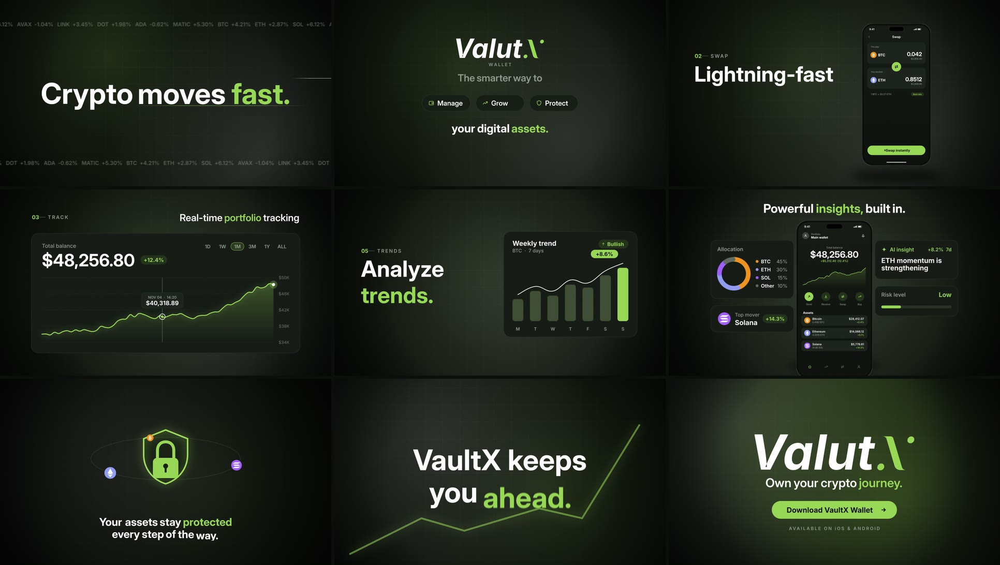

# VaultX Wallet — 45-second product motion ad

A 45-second, 1920×1080 fintech launch ad for **VaultX Wallet**, a crypto wallet, animated to a supplied AI
voiceover for a motion design test. It covers a logo build, phone UI for sends and swaps, a live **line
chart**, a **bar chart** with a trend line, a dashboard with insight cards, a **shield and fingerprint**
security sequence and a **logo end screen with a call to action**. It was built in **DaVinci Resolve's Fusion
page**: every comp is generated by Python as a native, fully labelled Fusion composition, then assembled,
mixed and rendered in Resolve.



| | |
|---|---|
| **Final cut** | [`deliverables/VaultX_Wallet_Ad_1920x1080_H264.mp4`](deliverables/) (1920×1080, 30 fps, 45.0 s, H.264 at 16 Mbps, −15.7 LUFS, −1.2 dBTP, Git LFS) |
| **Look** | Near-black green canvas, one soft glow, one lime accent from the logo (#91C950), Inter Display type |
| **Sync** | Every visual beat is pinned to a word in the voiceover, timed with word-level transcription |
| **Data viz** | A line chart that draws on with a counting balance and a scrub tooltip, and a weekly bar chart with a trend line |
| **Security** | A shield that draws on, a lock that closes over an encryption stream, a fingerprint traced under a scan line, tokens orbiting the locked shield |
| **Motion** | Bézier easing on every key (no linear moves except constant drifts), motion blur on every moving layer, masked kinetic type |
| **Sound** | A licensed music edit timed so the drop hits "VaultX keeps you ahead", plus 73 sound effect cues from 51 sounds, none used more than twice |
| **Project** | Nine comps, `C01` to `C09`, each element in its own labelled column, merged along one output spine |
| **Custom assets** | 24 icons, 3 token badges, 5 UI screens at 900×1860, design tokens ([`deliverables/assets/`](deliverables/assets/)) |

> The brief is in [`BRIEF.md`](BRIEF.md). The beat sheet, motion rules, design system and sound cue sheet are
> in [`BREAKDOWN.md`](BREAKDOWN.md). Every asset's source is in [`docs/ASSETS.md`](docs/ASSETS.md); the
> pipeline, Fusion measurements, render strategy and gotchas are in [`docs/PRODUCTION.md`](docs/PRODUCTION.md).

## The film in one glance

| Time | Scene | What happens |
|---|---|---|
| 0.0–3.5 | **Hook** | "Crypto moves fast. Your wallet should too." Kinetic type over speed streaks and a market ticker |
| 3.5–8.9 | **Logo** | The logo builds, then Manage, Grow and Protect pop on their words |
| 8.9–12.7 | **Transactions** | A send confirms on the phone, then a BTC→ETH swap, with toasts popping out of the screen |
| 12.7–16.9 | **Portfolio** | The line chart draws on as the balance counts up, then a cursor scrubs it |
| 16.9–20.2 | **Alerts, trends** | A price alert fires, then the bar chart rises with its trend line |
| 20.2–24.9 | **Dashboard** | Allocation, AI insight, risk and top-mover cards around the dashboard phone |
| 24.9–31.6 | **Security** | Shield, lock and encryption stream, fingerprint scan, then the protected orbit |
| 31.6–38.2 | **Modes** | Investing, Trading and Holding cards land on their words, then "VaultX keeps you ahead" on the drop |
| 38.2–45.0 | **End screen** | App splash with store badges, then the logo, "Own your crypto journey." and the CTA |

## Project layout

```
vaultx/
├── tools/
│   ├── fu.py                   # writes Fusion .comp files: nodes, Bézier keyframes, eases, XY paths, connections
│   ├── kit.py                  # pixel-space builders on top of fu: masks, fills, text, transforms, motion blur, freezes
│   ├── vx_common.py            # design system, voiceover word times, scene table and shared builders
│   ├── scenes_a.py · scenes_b.py · scenes_c.py   # the nine scenes
│   ├── mix_audio.py            # voiceover clean-up, music edit, SFX cue sheet, stems and reference mix
│   ├── make_sfx.py             # the synthesised UI sounds
│   ├── make_lua_setup.py · make_resolve_audio.py · make_lua_assets.py   # Resolve Console scripts
│   ├── export_assets.py · make_ui_assets.py      # icons, tokens, UI screens
│   └── finalize.py             # joins the scene renders, encodes the master, verifies it
├── build/comps/                # C01–C09 scene comps and UI_01–UI_05 screen comps (generated)
├── assets/audio/               # music (CC BY 3.0), every sound effect used, the synthesised ones
├── assets/fonts/               # Inter and Inter Display (OFL)
├── deliverables/               # final master [Git LFS], custom assets, the delivery README
├── docs/                       # ASSETS, PRODUCTION, VO_TIMELINE, STYLE_RESEARCH, media/
├── brandkit/                   # the client's logo, script and voiceover        [not in repo]
├── build/audio/ · build/stills/                                                  [not in repo]
└── BRIEF.md · BREAKDOWN.md
```

## Rebuild

`brandkit/` holds the client's logo and voiceover. It is not in this repo, so the comps and the mix cannot be
rebuilt without it.

```sh
python -I tools/mix_audio.py                     # build/audio/: stems, 73 SFX clips, reference mix
python -I tools/scenes_a.py && python -I tools/scenes_b.py && python -I tools/scenes_c.py   # build/comps/
python -I tools/make_lua_setup.py                # then load the comps into Resolve from its Console
python -I tools/finalize.py                      # after rendering each scene from Resolve as ProRes
```

The Resolve steps, the Console helpers and why scenes render in pieces are in
[`docs/PRODUCTION.md`](docs/PRODUCTION.md). Needs Python 3.12 with numpy and Pillow, ffmpeg and DaVinci
Resolve 21 (free).

## Rights

VaultX's logo, script and voiceover belong to the client and were supplied for this test; none of those files
is committed. The logo is drawn into the comps unmodified from the supplied SVG, and its wordmark reads
"Valut.X" as supplied. All numbers, balances and charts are illustrative. The music is "Innovation Needed" by
ZoneX (Jamendo), licensed [CC BY 3.0](https://creativecommons.org/licenses/by/3.0/). Inter and Inter Display are
by Rasmus Andersson (SIL OFL 1.1). The icons, UI, charts, animation and synthesised sounds were made for this
project.

Built with [Claude Code](https://claude.com/claude-code): the comp generator, scenes, mix, Resolve scripting
and render were done by Claude Code, directed and reviewed by the author.
